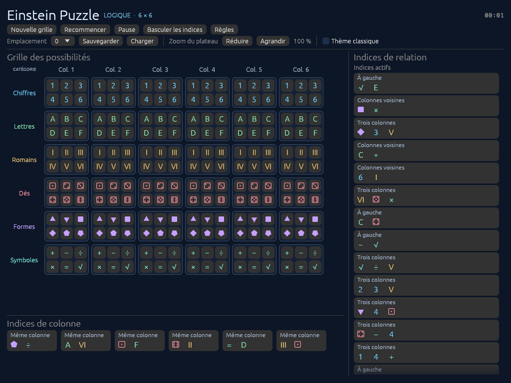

# Einstein Puzzle — native Rust reconstruction

A native Rust reimplementation of the 6×6 logic puzzle. The workspace provides a shared rules/session/storage layer used by three executables: an eframe GUI, a line-oriented CLI, and an MCP server over stdio. No browser or network service is required.



*The screenshot shows the vector-themed GUI with seed 42 at 1024×768; the interface labels are currently in French.*

## Attribution and licensing

The reference game is Einstein Puzzle, originally credited to Flowix Games (© 2003–2005); the public C++ source used for comparative study credits Flowix and notes modifications by Jordan Evens (2012). This repository is a Rust reconstruction and does not bundle the upstream executable. The repository's existing license is **GPL-2.0-or-later**; no MIT relicensing is supported by the available rights record. The bundled 40 classic-theme bitmaps are credited to Alexander Babichev / Flowix under GPL-2-or-later. See their verbatim Debian copyright notice and checksums in the [asset provenance record](assets/classic/README.md), the English [asset license summary](ASSETS_LICENSES.md), and [third-party notices](THIRD_PARTY_NOTICES.md).

The verified locked GUI dependency graph includes Apache-2.0-only components. For a combined GUI distribution, GPLv3-or-later is the compatible project-level option; each component's own terms and notices still apply. The current [Wayland-enabled GUI dependency inventory](licenses/gui/inventory-wayland.json) passes the repository's notice verifier. This is not a legal-compliance certification or a complete SBOM for system libraries or a particular packaged binary. No binary release is offered here.

## Requirements

- Rust stable 1.95 or newer, with Cargo.
- Linux with a graphical X11/Xwayland or Wayland session and OpenGL for the native GUI.
- A C compiler and Linux development packages required by winit/Glutin (the CI workflow installs the Ubuntu packages used for its build).

## Build and run the GUI

```sh
cargo build --workspace --locked
cargo run -q --locked -p einstein-gui --bin einstein-gui -- --size 1024x768 --seed 42
cargo run -q --locked -p einstein-gui --bin einstein-gui -- --classic --size 800x600 --seed 42
```

GUI options: `--size WIDTHxHEIGHT` (minimum 640×480), `--seed UINT64`, `--save-dir DIRECTORY`, `--classic`, `--help`/`-h`. Linux builds both X11 and Wayland; the existing renderer is Glow using Glutin (X11 GLX/EGL, Wayland EGL). If Wayland startup fails with `Glutin ... NotSupported("provided native window is not supported")`, inspect `XDG_SESSION_TYPE`, `WAYLAND_DISPLAY`, `WAYLAND_SOCKET`, `DISPLAY`, and `XDG_CURRENT_DESKTOP`. Do not change the compositor or system-wide environment to work around it. `RUST_BACKTRACE=1` helps if a panic occurs; `RUST_LOG=debug` is not guaranteed to emit logs because the application does not install a logger.

The GUI opens a generated puzzle directly. Left-click or Enter selects a candidate; right-click or Delete excludes it. Tab/Shift+Tab move among controls, arrow keys move focus, F6/Shift+F6 change navigation zones, and Ctrl+Home/End move to the ends of a zone. The GUI exposes named controls through AccessKit and includes a classic visual theme and zoom controls. Current GUI labels are in French (for example, `Nouvelle grille`, `Recommencer`, `Pause`, `Règles`). The classic theme uses the allowlisted Debian bitmap set documented above; it is not pixel-identical to the historical SDL UI.

## CLI

The CLI reads one local command per UTF-8 line, writes one JSON result per line, and exits at EOF. Available options: `--save-dir DIRECTORY`, `--no-clock`, `--help`/`-h`.

```sh
cargo run -q --locked -p einstein-adapters --bin einstein-cli -- --help
printf 'new 42\nstate\nexclude 1 1 2\nstate\nselect 1 1 5\nstate\nsave 0\nend\nstate\n' | \
  cargo run -q --locked -p einstein-adapters --bin einstein-cli -- --no-clock --save-dir /tmp/einstein-cli
printf 'new 7\nstate\nsave 0\nnew 8\nload 0\nstate\n' | \
  cargo run -q --locked -p einstein-adapters --bin einstein-cli -- --no-clock --save-dir /tmp/einstein-cli-reload
```

Commands: `new SEED`, `state`, `select CATEGORY COLUMN VALUE`, `exclude CATEGORY COLUMN VALUE`, `toggle-hint ID`, `switch-hints`, `pause`, `resume`, `restart`, `end`, `save SLOT`, and `load SLOT`. Categories, columns, and values are 1–6; slots are 0–9. `state` reveals candidates, clues, status, and elapsed time—not the hidden solution. There is no user-facing `solve` command or hidden-answer query. Seeds are Rust generator seeds, not historical SDL seeds.

## MCP over stdio

Build and launch the MCP adapter with this exact command:

```sh
cargo run -q --locked -p einstein-adapters --bin einstein-mcp -- --no-clock --save-dir /tmp/einstein-mcp
```

Configure an MCP client to run `einstein-mcp` as a stdio subprocess. It negotiates MCP over JSON-RPC stdio, advertises 12 tools corresponding to the session actions above, and has no HTTP listener. The save directory is fixed at process launch, not by an MCP tool; decimal seed arguments are strings. A reproducible initialize/list/new/state transcript is in [Validation](docs/VALIDATION.md).

## Validation

Run the standard checks from the workspace root:

```sh
cargo fmt --all -- --check
cargo clippy --workspace --all-targets --locked -- -D warnings
cargo test --workspace --locked
cargo build --workspace --release --locked
```

The sampled SDL/Rust comparison records 18 scenario rows: **14 PASS, 2 DIFFERENCE, 1 BLOCKED, 1 UNMEASURED**. This is behavioral sampling, not a claim of global equivalence. The detailed public-safe test scope, backend limits, command transcripts, and license checks are in [Validation](docs/VALIDATION.md).

## Contributing

This project was developed with AI assistance from Sol and Luna using DeepSeek Harness and OpenAI models. The human maintainer retains responsibility for project decisions, code, documentation, and any published changes. No copyright or commit authorship/co-authorship is attributed to AI tools.

Contributions are welcome. Keep changes focused, add or update tests for behavior changes, use deterministic seeds when possible, and report the exact command/environment used for graphical checks. Before a pull request, run the validation commands above. Do not add original-game binaries, extracted/disassembled material, private saves/captures, unreviewed third-party assets, credentials, or generated build artifacts. License or notice changes require the dependency and asset provenance checks; do not assume an MIT relicense.
